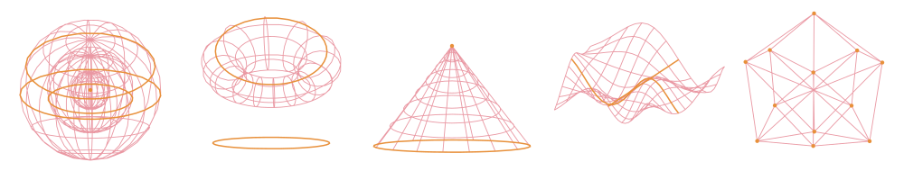

  

## Hi, I'm Yassine 👋

I'm a PhD student in mathematics at the **Université de Sherbrooke** (Québec, Canada), working on **Poisson geometry**, Lie groupoids and shifted symplectic structures, with a background in graded noncommutative algebra.

Alongside research, I build small, private, open-source tools for researchers and teachers: things that run on your own computer, need no account, and do one job well.

### Projects

| | Project | What it does |
|---|---|---|
| 🗂️ | **[VanoAtlas](https://github.com/yassine-aitmohamed/vanoatlas)** | A local research workspace: projects, tasks, meetings, notes, papers and LaTeX in one private app. macOS, Linux, Windows. |
| 📝 | **[VanoLeaf](https://github.com/yassine-aitmohamed/VanoLeaf-LaTeX-Editor)** | A LaTeX editor in the spirit of Overleaf that runs on your machine, with no compile timeout, SyncTeX and offline use. |
| ✍️ | **[VanoNote](https://github.com/yassine-aitmohamed/VanoNote)** | A handwritten notebook and classroom whiteboard: pen tablets, PDF annotation, a one-key blackboard mode and live links for students. |
| 📄 | **[VanoLib Reader](https://github.com/yassine-aitmohamed/vanolib-extension)** | A PDF reader for papers in Chrome, Edge and Brave: citation cards, verified references, annotations, figure previews. |
| 🕶️ | **[VanoVeil](https://github.com/yassine-aitmohamed/vanoveil)** | A private corner inside Chrome: a password-protected link bar, a hidden workspace and a one-key privacy veil. |

All of them are MIT-licensed. Bug reports and suggestions are always welcome.

### Built with

